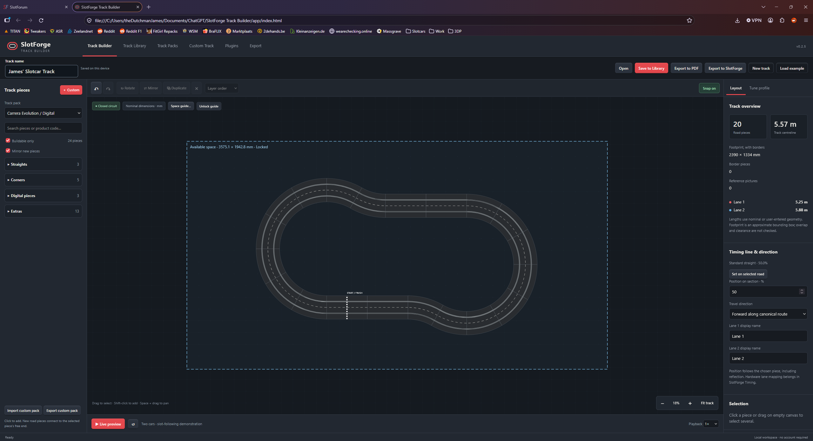
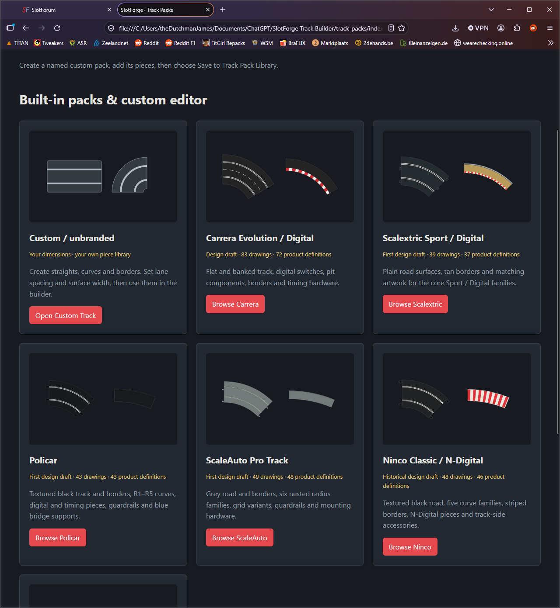
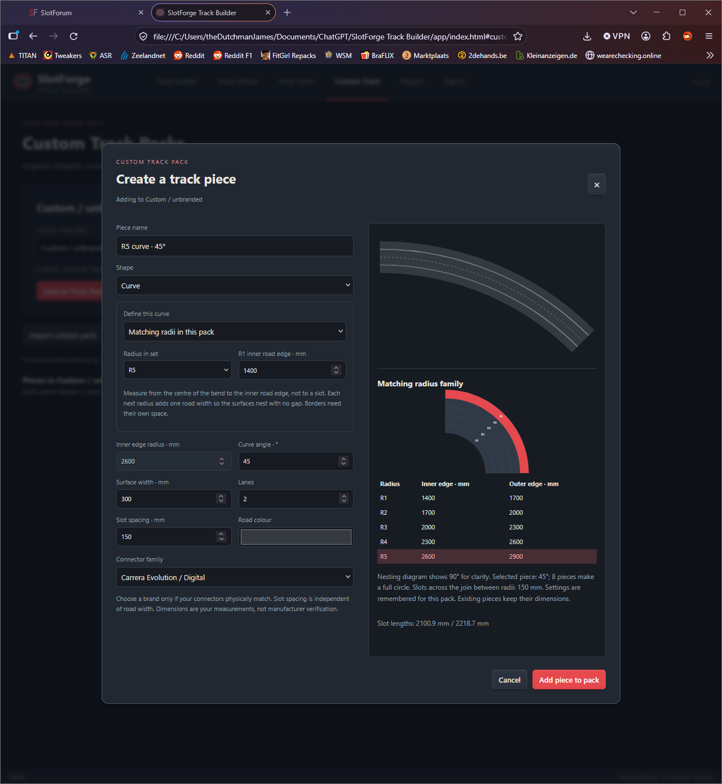
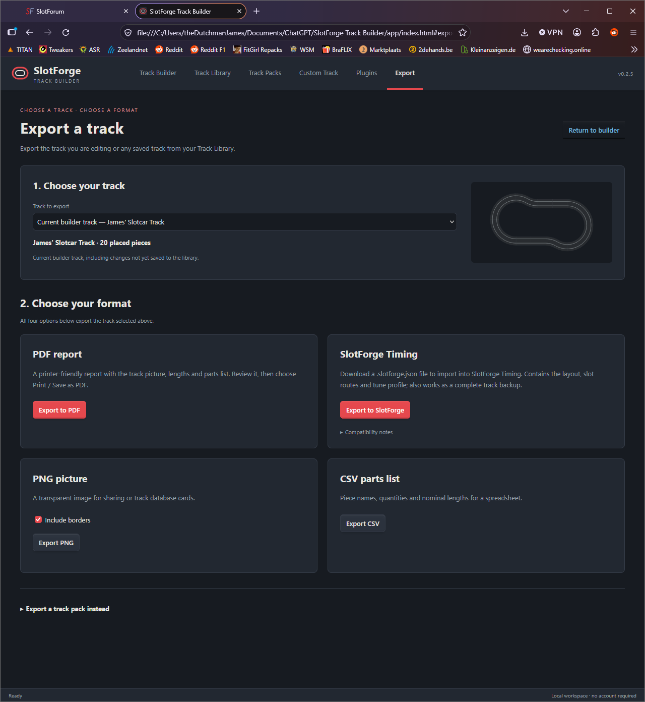

<p align="center"></p>

# SlotForge Track Builder

### Design it. Build it. Race it.

Turn the space you have into the circuit you want. **SlotForge Track Builder** is a visual slot-car track planner that combines physical piece geometry with a flexible drag-and-snap editor. Plan your next layout, explore a live preview, and take a clear parts list to the real build.

**Current version: 0.2.5 · Runs in your browser · No account required**

[Download the complete app](downloads/SlotForge-Track-Builder-v0.2.5-complete.zip) · [Getting started](START-HERE.txt) · [Detailed notes](README.txt) · [SlotForge Timing](https://github.com/theDutchmanJames/SlotForgeTiming)

## Screenshots

**Track Builder** — plan a circuit with a locked space guide, lane lengths and a start/finish line.

[](docs/screenshots/track-builder.png)

| Track packs | Custom-piece editor | Export |
| --- | --- | --- |
| [](docs/screenshots/track-packs.png) | [](docs/screenshots/custom-piece.png) | [](docs/screenshots/export.png) |
| Browse branded packs or create your own. | Define dimensions, lane spacing and matching curves. | Choose a track and the format you need. |

Click any screenshot to view it at full size.

## From an idea to a physical layout

- **Build by feel.** Drag, snap, rotate, reflect and duplicate pieces. Select several at once, arrange their drawing order and undo changes.
- **Plan around your room or table.** Add a space guide with exact length and width. Move, resize or scale it, then lock it so it stays out of the way while building.
- **Keep the geometry honest.** Piece dimensions, lane spacing, matching curve radii and borders determine the layout. See parts counts, footprint, track centreline length and per-lane lengths for supported closed circuits.
- **Make your own track system.** Create named custom packs with straights, matching R1/R2/R3 curves, borders and lane changers. Save them to the pack library, then import or export them as data-only plugins.
- **See it in motion.** Preview two cars following the slots. Tune speed, acceleration, braking, cornering and visual drift with a shared animation profile.
- **Keep your favourites.** Save independent layouts in the Track Library, including their timing settings, tune profile and space guide.
- **Take the design with you.** Export a printer-friendly PDF report, a transparent PNG, a CSV parts list or a complete `.slotforge.json` layout for the SlotForge Timing integration. Choose the current track or a saved library track.

## Supplied track packs

| Track system | Pack |
| --- | --- |
| Carrera | Evolution / Digital |
| Scalextric | Sport / Digital |
| Policar | Policar track system |
| ScaleAuto | Pro Track |
| Ninco | Classic / N-Digital |
| SCX | Universal / Classic / Advance reference catalogue |

Each pack has matching artwork and source notes. Support varies by piece: supported geometry can snap and contribute to route calculations; incomplete or special pieces can be placed as reference pictures. **SCX is currently reference-only.**

## Get started

1. [Download the complete ZIP](downloads/SlotForge-Track-Builder-v0.2.5-complete.zip) and extract it fully.
2. Open **SlotForge Track Builder.html** in a current desktop browser.
3. Choose a track pack and start placing pieces, or load the example circuit.

Keep the supporting folders together. There is no build step or npm installation. On Windows, the included **Create Windows shortcut.vbs** can create a shortcut with the app icon for your extraction location.

For a consistent local browser-storage address, run the optional server with a current Node.js runtime:

```sh
node app/serve.cjs
```

Then open **http://127.0.0.1:8173/app/**. The server listens only on your own computer. If another copy is already using that port, stop it before starting this one.

Your Track Library and custom packs live in your browser on that device. Use JSON exports as portable backups. Switching browser, folder or between `file://` and `localhost` can show a different workspace. The downloadable package does not include anyone's personal saved library.

## SlotForge Timing integration

The `.slotforge.json` export includes the design, embedded piece definitions, validated slot routes, nominal lane lengths, timing-line settings, stable identities and a shared animation profile. The receiving application can regenerate the drawing without a separate PNG.

- Layout envelope: **`slotforge.layout` version 1**.
- Integration contract: **`1.0.0-draft.2`**.
- [Base specification](integration/slotforge-timing/EXPORT-SPEC-1.0.0-draft.1.txt) and [draft.2 additions](integration/slotforge-timing/EXPORT-SPEC-1.0.0-draft.2.txt).
- [Receiving-side workflow](integration/slotforge-timing/TIMING-IMPORTER-CHANGES.txt).

Receiving-side support is coordinated with [SlotForge Timing](https://github.com/theDutchmanJames/SlotForgeTiming). The animation profile shapes estimated movement; real sensor crossings remain authoritative for laps and race results.

## Current boundaries

This is an early desktop-browser iteration. Dimensions are nominal or user-entered planning values. The editor does not certify physical fit or detect collisions, bridges or vertical clearance. The space guide is a visual aid. Preview and lane calculations follow a single supported closed circuit using straight-through lane-changer routes; digital switching and pit-route simulation are outside the current scope. PDF export uses the report preview followed by the browser's **Print / Save as PDF** command.

## Work on the project

The app uses plain HTML, CSS and JavaScript, with no external runtime package dependency.

| Folder | Contents |
| --- | --- |
| `app/` | Editor, geometry/integration runtime, local server and tests |
| `track-packs/` | Track catalogues, SVG artwork, source notes and generators |
| `designs/` | Shared visual style and early design studies |
| `integration/slotforge-timing/` | Integration specifications and example fixtures |
| `downloads/` | Ready-to-share complete app ZIP |

Run the source tests with a current Node.js runtime:

```sh
node --test app/core.test.cjs app/integration.test.cjs app/custom-packs.test.cjs app/editor-features.test.cjs app/library.test.cjs app/track-exports.test.cjs app/space-guide.test.cjs app/server.test.cjs
node integration/slotforge-timing/check-fixtures.cjs
```

The v0.2.5 package was checked with **86 passing source tests and 15 passing integration fixtures**. See [validation details](app/validation.json) for the scope and limitations. Rebuild the complete ZIP with Python 3 using `python app/package-share.py`.

Found a rough edge or have an idea for a new piece? [Open an issue](https://github.com/theDutchmanJames/SlotForgeTrackBuilder/issues) with the track system, piece details and a small example layout where possible.
